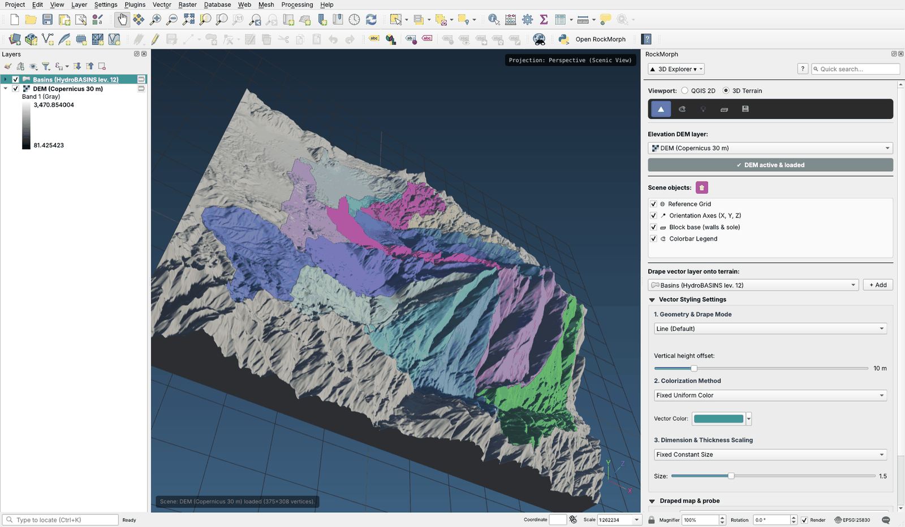
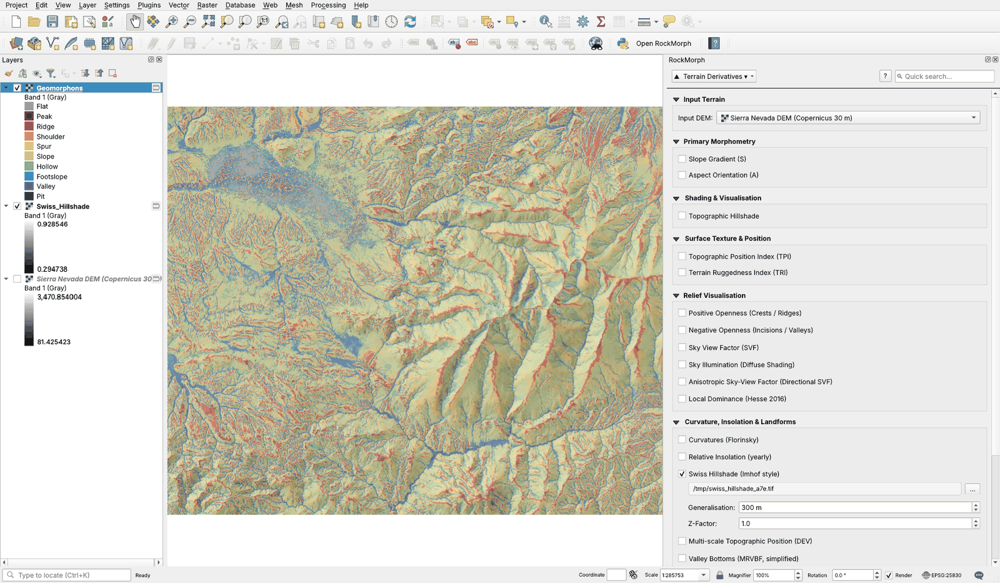
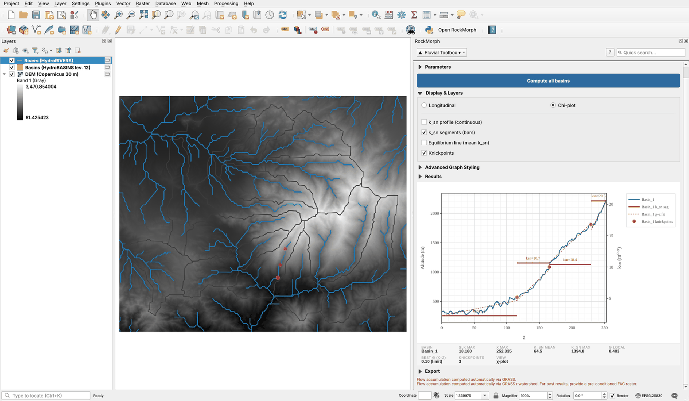
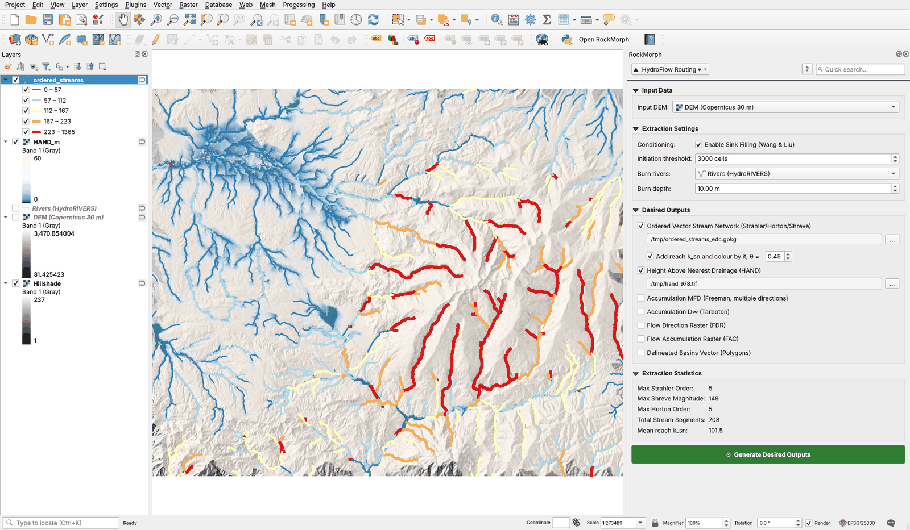
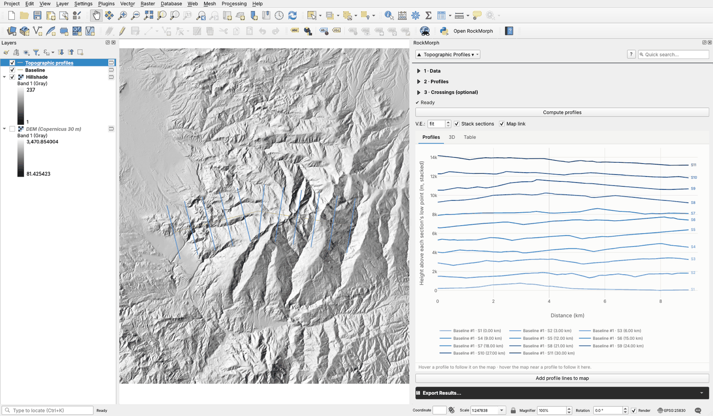
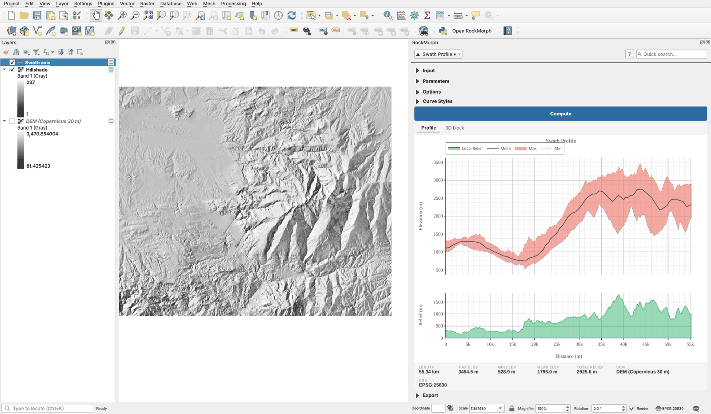
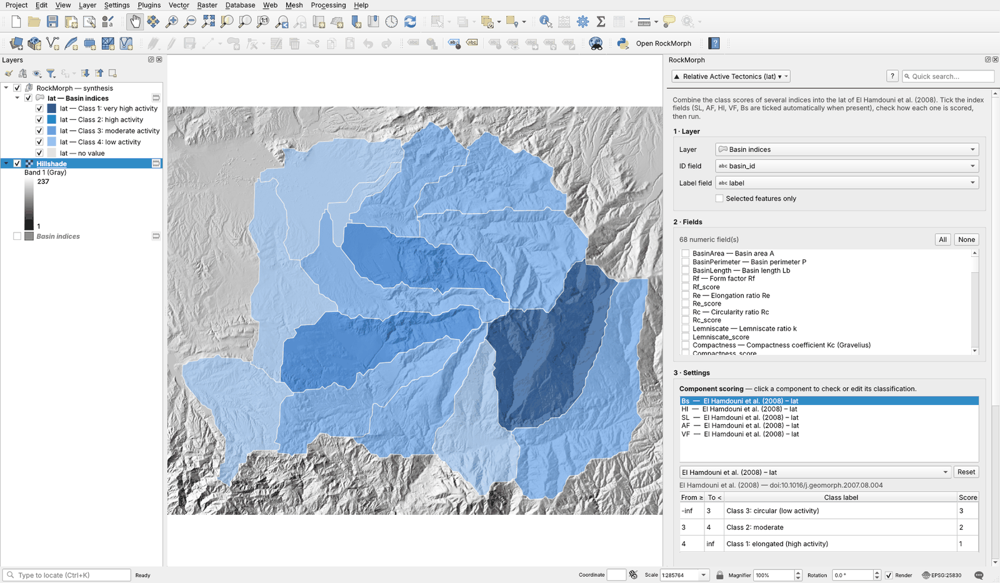
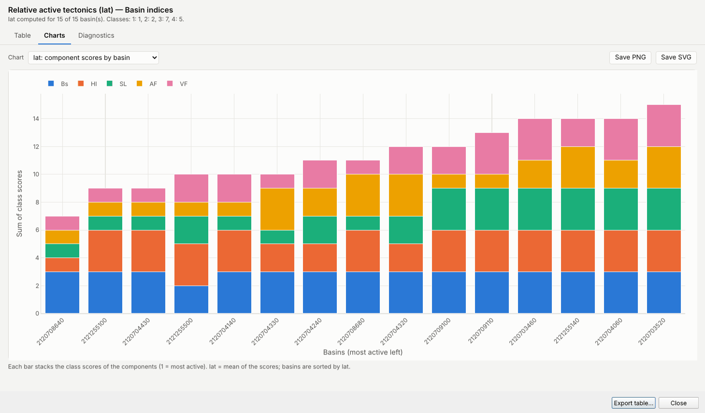
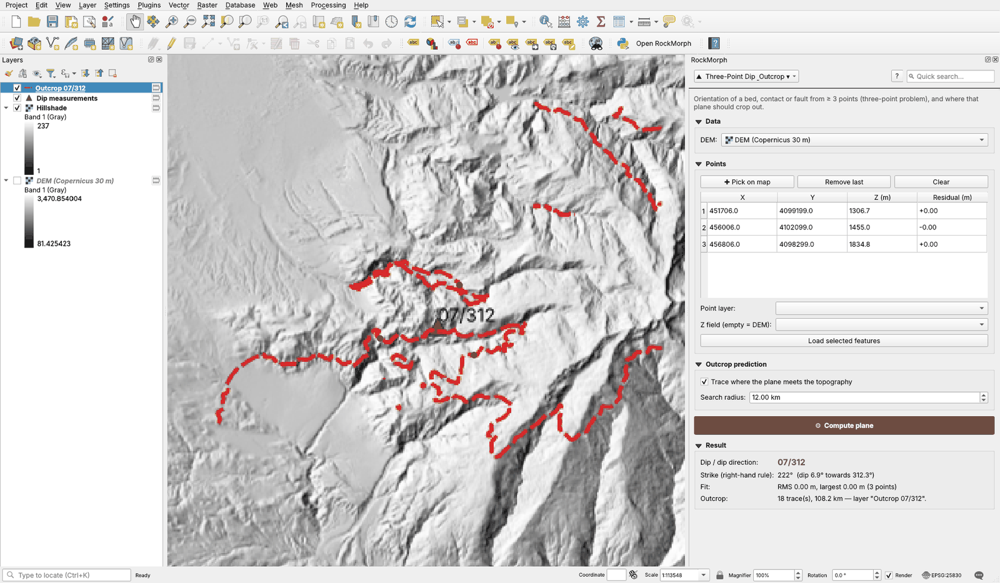

<p align="center">
  
</p>

<h1 align="center">RockMorph</h1>

<p align="center">
  <b>A complete geomorphology workstation inside QGIS — from the DEM to the publication figure.</b><br>
  Terrain analysis · hydrology · river profiles · active tectonics · structural geology · 3D
</p>

<p align="center">
  
  
  
  
  
</p>

<p align="center">
  
  <br><sub>3D Explorer inside QGIS — Sierra Nevada (Spain), Copernicus DEM 30 m, HydroBASINS level-12 basins draped with their QGIS style.</sub>
</p>

---

RockMorph gathers in one dock everything a geomorphologist does with a DEM: derive the land surface,
extract and order the drainage network, analyse river profiles in χ space, compute and classify the
published morphometric indices of every basin, combine them into an index of relative active
tectonics, cut profiles and swaths, measure structural planes, and look at it all in 3D.
Every result is a **QGIS layer** or an **interactive chart** (Plotly), exportable to PNG, SVG,
CSV or GeoPackage. Every method cites its source.

All figures below are **real screenshots of QGIS 3.44** running RockMorph on open data:
the Copernicus GLO-30 DEM of the Sierra Nevada (Spain), HydroBASINS and HydroRIVERS.

## Contents

- [Tools](#tools)
- [Gallery](#gallery)
- [Installation](#installation)
- [Quick start](#quick-start)
- [Methods and references](#methods-and-references)
- [Quality and tests](#quality-and-tests)
- [Project layout](#project-layout)
- [License](#license)
- [Author](#author)

## Tools

| Family | Tool | What it gives you |
|---|---|---|
| **Topography** | **Terrain Derivatives** | Slope, aspect, hillshade (standard, multidirectional, Igor), TPI, TRI, positive/negative openness, sky-view factor, sky illumination, local dominance; **curvatures** (profile, plan, mean, Gaussian, kmin, kmax), **yearly relative insolation**, **Swiss hillshade**, **multi-scale DEV**, **valley bottoms (MRVBF)**, **Iwahashi & Pike landforms**, **geomorphons** |
| | **Topographic Profiles** | Profiles along lines or drawn on the map, **serial cross-sections** (stacked), crossings with faults or contacts, main river of a basin, 2D ↔ map hover link, 3D view |
| | **Swath Profile** | Min / max / mean / quartiles envelope and local relief along an axis, 3D swath block linked to the map |
| | **Hypsometric Curve** | Hypsometric curve and integral per basin |
| | **Watershed Subdivision** | Basins from outlets, sub-basins by stream order, polygon tracing |
| **Fluvial** | **HydroFlow Routing** | Sink filling, **stream burning** of a mapped network, ordered network (Strahler, Horton, Shreve), **HAND**, **MFD** and **D∞** accumulation, **k<sub>sn</sub> of every reach** |
| | **Fluvial Toolbox** | Longitudinal profile, SL and SL/K, **χ-plot**, knickpoints (BIC segmentation), k<sub>sn</sub> continuous and per segment, **χ–z line per segment**, **best concavity θ**, Hack equilibrium profile |
| | **Normalized Channel Profile** | Normalised profiles, concavity and comparison between rivers |
| | **Mountain-Front Sinuosity** | S<sub>mf</sub> with automatic front detection and Iat classes |
| **Morphometry** | **Morphometric Indices** | **60 published indices** (shape, relief, hypsometry, Horton–Strahler, SL, k<sub>sn</sub>, χ, AF, T, V<sub>f</sub>, TWI…) with their classifications, units and references; results window with table, maps and charts |
| **Synthesis** | **Relative Active Tectonics (Iat)** | El Hamdouni et al. (2008) from classified indices, class map and component chart |
| | **AHP Weighting** | Saaty pairwise matrix, consistency ratio, **weight sensitivity** (±10 %, ±20 %) |
| | **Composite Index** | Mean, weighted mean, min, max or first principal component of rescaled indices |
| | **Statistics & Machine Learning** | PCA, k-means, hierarchical clustering, DBSCAN, t-SNE / UMAP, Isolation Forest, LOF |
| **Structural** | **Three-Point Dip & Outcrop** | Dip / dip direction of a bed or fault from ≥ 3 points, RMS fit, **predicted outcrop trace** |
| | **Rose Diagram** | Strike and dip-direction rose diagrams, axial statistics |
| | **Geological Digitizer** | Topological tools to digitise geological maps |
| **3D** | **3D Explorer** | Realistic terrain (cast shadows, sky light, haze), natural land cover, **any layer draped with its QGIS style**, draped vectors, **hover probe linked to the map**, PNG / STL / HTML export |

## Gallery

### Land-surface parameters — geomorphons over a Swiss hillshade


Ten landform elements (Jasiewicz & Stepinski, 2013) computed on the 2 245 × 1 842 DEM and styled
with their legend, over a Swiss-style relief shading (Jenny, 2001). Curvatures, insolation, DEV,
valley bottoms and Iwahashi–Pike classes come from the same group.

### χ-plot with knickpoints and χ–z segment lines


Main river of each HydroBASINS basin, χ–elevation profile with BIC knickpoints (red dots, also on
the map), k<sub>sn</sub> per segment and the least-squares χ–z line of each segment (dotted). The
best concavity is searched automatically and flagged when it is not constrained.

### HAND and reach steepness of the whole network


HydroRIVERS burned into the DEM, ordered network (Strahler 5, 708 reaches) coloured by reach
k<sub>sn</sub>, over the Height Above the Nearest Drainage (blue = low ground close to the channels).

### Serial cross-sections


Eleven sections every 3 km across the range, stacked; hovering a section moves a marker on the map
and the other way round.

### Swath profile


55 km swath, 5 km wide: maximum, mean and minimum elevation and local relief.

### Relative active tectonics (Iat)



Iat of El Hamdouni et al. (2008) from SL, AF, HI, V<sub>f</sub> and B<sub>s</sub>: class map and the
contribution of each index per basin.

### Three-point dip and predicted outcrop


Three points picked on the map give the plane (dip / dip direction); its intersection with the
topography is traced as the predicted outcrop (red dashed lines).

## Installation

**Requirements**

- QGIS ≥ 3.36 with Qt WebEngine (included in the official Windows and macOS installers;
  on Linux install `python3-pyqt5.qtwebengine` or your distribution's equivalent).
- NumPy and SciPy (shipped with QGIS).
- Optional: the GRASS provider (stream extraction in HydroFlow, automatic flow accumulation),
  `scikit-learn` and `umap-learn` for the extra machine-learning methods.

**From GitHub**

```bash
git clone https://github.com/PerfectWin7777/RockMorph.git
```

Then make the folder visible to QGIS — either copy it, or link it so that `git pull` updates the plugin:

| System | Plugin folder |
|---|---|
| Windows | `%APPDATA%\QGIS\QGIS3\profiles\default\python\plugins\RockMorph` |
| macOS | `~/Library/Application Support/QGIS/QGIS3/profiles/default/python/plugins/RockMorph` |
| Linux | `~/.local/share/QGIS/QGIS3/profiles/default/python/plugins/RockMorph` |

```bat
:: Windows (cmd), link instead of copy
mklink /J "%APPDATA%\QGIS\QGIS3\profiles\default\python\plugins\RockMorph" "C:\path\to\RockMorph"
```

Restart QGIS, enable **RockMorph** in *Plugins › Manage and Install Plugins › Installed*, and click
**Open RockMorph** in the toolbar.

## Quick start

1. Load a projected DEM (UTM is ideal; geographic DEMs are handled with metric conversions).
2. *Topography › Terrain Derivatives*: tick the parameters you need and compute.
3. *Fluvial › HydroFlow Routing*: extract the ordered network (optionally burn a mapped river
   network) and HAND.
4. *Fluvial › Fluvial Toolbox*: choose basins and the network, inspect the χ-plot of each basin.
5. *Morphometry › Morphometric Indices*: pick a preset (e.g. *Iat – El Hamdouni et al. 2008*),
   compute, then open *Synthesis › Iat* on the result layer.
6. *3D › 3D Explorer*: render the DEM, drape a geological map, hover to probe.

Each tool has a **?** button that opens its help page.

## Methods and references

Every index and algorithm documents its source in the code and in the tool tooltips. The main ones:

- **Land surface** — Evans (1979); Florinsky (2016); Yokoyama et al. (2002); Zakšek et al. (2011);
  Kumar et al. (1997); Jenny (2001); Lindsay et al. (2015); Gallant & Dowling (2003);
  Iwahashi & Pike (2007); Jasiewicz & Stepinski (2013).
- **Hydrology** — Barnes et al. (2014) Priority-Flood; Wang & Liu (2006); O'Callaghan & Mark (1984);
  Freeman (1991); Tarboton (1997); Rennó et al. (2008); Strahler (1952); Shreve (1966).
- **Rivers** — Hack (1973); Perron & Royden (2013); Kirby & Whipple (2001, 2012); Wobus et al. (2006).
- **Tectonic geomorphology** — Bull & McFadden (1977); Cox (1994); El Hamdouni et al. (2008);
  Saaty (1980); Pérez-Peña et al. (2010).
- **Structural geology** — Ragan (2009).

The implementation journal [`doc/07_journal_refactorisation.md`](doc/07_journal_refactorisation.md)
records every scientific choice, every difference with the literature or with GSV-Studio, and the
tests on real data.

## Quality and tests

- Pure-NumPy libraries (`core/indices`, `core/terrain_metrics.py`, `core/structural.py`) with
  **unit tests on analytic surfaces** — run `python -m pytest tests` (no QGIS needed).
- Long computations run in background threads with progress and **Cancel**; layers are read
  thread-safely.
- Checked on real data in projected and geographic CRS (Copernicus DEM, HydroBASINS, HydroRIVERS).

## Project layout

```
base/      shared panel, engine, worker thread, tool registry
core/      raster I/O, hydrology, sampling, pure index and terrain libraries
tools/     one folder per tool: engine.py (computation) + panel.py (interface)
web/       chart and 3D pages (Plotly, three.js)
widgets/   reusable widgets (results window, output selectors, colour ramps)
docs/      help pages opened by the ? button
doc/       implementation journal
tests/     unit tests (pytest)
```

## License

RockMorph is free software, released under the **GNU General Public License, version 2 or (at your
option) any later version** — the license of QGIS itself. See [LICENSE](LICENSE).

## Author

**Tony Winter**

- Professional: [wintertony7777@gmail.com](mailto:wintertony7777@gmail.com)
- Personal: [wintertony410@gmail.com](mailto:wintertony410@gmail.com)

Issues and suggestions are welcome on the
[issue tracker](https://github.com/PerfectWin7777/RockMorph/issues).
